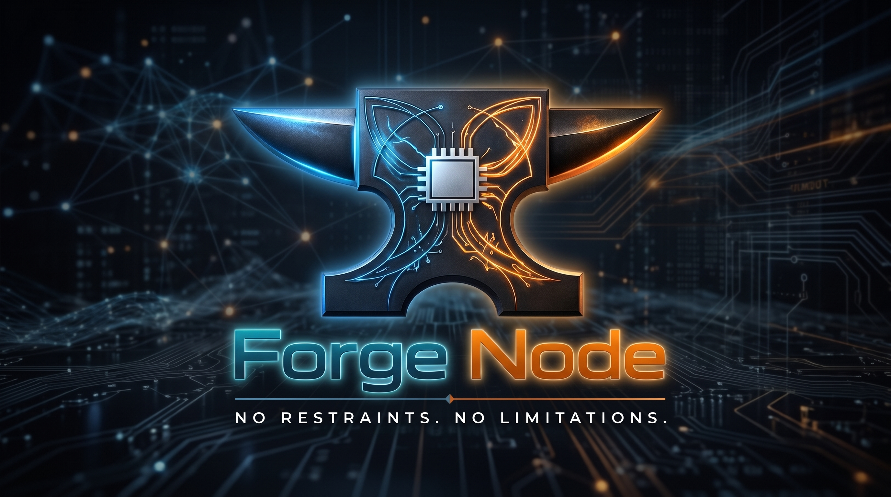
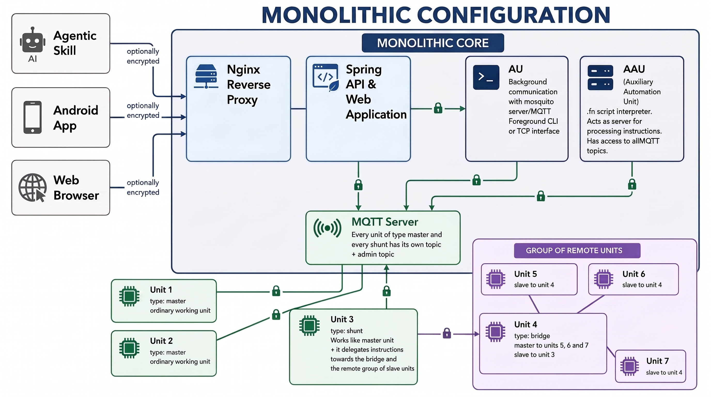
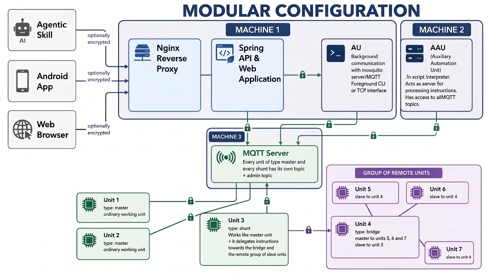

# Forge Node

## News
- since November 22. Forge Node is ready for testing.

## Video tutorials
- [Introduction and fast setup](https://youtu.be/HvorUbc178w)

## Intro

Forge-Node is built for people who want their smart home — or factory, greenhouse, lab, or any other automated system — to be truly theirs.

Instead of constantly dealing with both the electrical and software sides of the system, you set up the hardware once. From that point on, you express and evolve the entire logic in a simple `.fn` script. You work with high-level primitives such as switches, sensors, transmitters, and programs, rather than with pins, voltages, or low-level electronics.

Once the nodes are installed and running, you can tweak, reconfigure, or completely rewrite the behavior in real time — without soldering, using a multimeter, or reflashing any microcontroller. The system stays under your full control.

## How to install it

Navigate into project root directory and use docker to create image with command `docker build -t forge-node:latest .` Then first check docker-compose.yml for custom settings. After that is done `docker compose up -d` in order to start docker container. Interface is exposed on port 10011 and default credentials are admin1 password.

## Documentation
- [What this solution contains](./docs/what_this_solution_contains.md)
- [How it works](./docs/how_it_works.md)
- [How communication works](./docs/how_communication_works.md)
- [Communication over administrative channel](./docs/communication_over_administrative_channel.md)
- [FN Script](./docs/fn_script.md)
- [AU](./docs/au.md)
- [Split system and wrappers](./docs/split_system_and_wrappers.md)
- [REST API](./docs/rest_api.md)

## Supported configurations

## DISCLAIMER
The motto “no restraints, no limitations” reflects the design philosophy of Forge Node — specifically, that the system is built not to harvest user data and not to impose artificial restrictions on feature access. It is not a guarantee of unrestricted functionality, reliability, or fitness for any particular purpose. Use of this software is at your own risk.